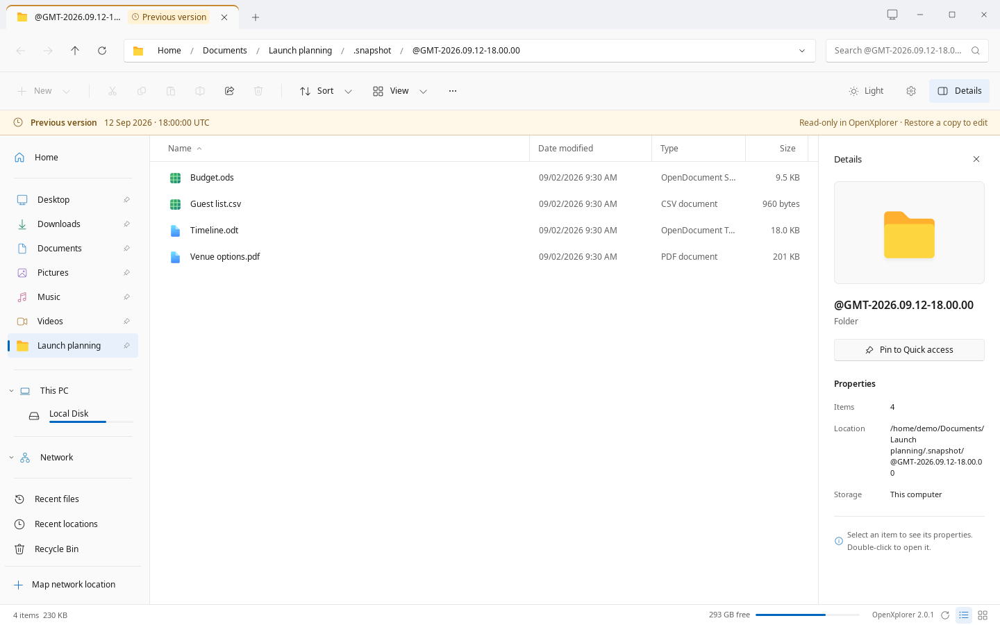
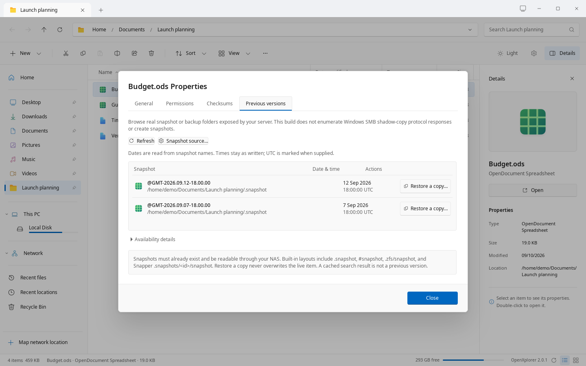

# Interface & snapshots

Make the workspace fit the way you work.

## Your workspace, your widths

Resize the sidebar and column edges. Double-click an edge to reset or fit it, depending on the control. Width preferences survive restarts. Local and SMB ancestors remain individual breadcrumb buttons. As in Windows 11, the arrow before the first one lists Home, This PC, Network and the Recycle Bin, the arrow after each one lists all of its subfolders, and on a long path the first ones fold into a « button that lists them.



*The native app, captured with fictional sample files. No live NAS connection.*

## Choose a folder view

View offers Details, List, icon sizes, Tiles and Content. Use Ctrl+mouse wheel or the icon sizes in View to change icon size; as in Windows, the wheel steps through Details, List and the icon sizes but not Tiles or Content. Tiles shows each item's icon with its name, type and size beside it, in columns that fill the window; Content lists one item per row, its name and type (a folder's name alone) beside its icon and its date modified and size at the right. A grouped folder keeps its groups in Tiles and Content, each under a heading with its name, count and a line, as in Details. Settings → Files & folders → Expandable folders in Details lets Details expand folders in place (off by default, as in Windows Explorer); drag from empty space to select items, hold Ctrl to toggle them or Shift to add them. In Details, as in Windows, a click anywhere on a row selects it; a drag from the part of a row past the end of its name (or from its Date, Type and Size columns) draws a selection rectangle while the row is not selected, so you can select rows even when the folder fills the window. View → Compact view, also in Settings → Appearance → Files and folders, draws the Details rows and the navigation pane closer together, as in Windows 11, so more items fit. View → Item check boxes, on by default as in Windows 11, gives each item a check box that shows while you point at it and stays checked while it is selected; click it to select or deselect that item alone, or use the box before Name in Details to select every item, and again to select none.

Right-click a Details heading to choose columns, then drag headings to reorder them. The Recycle Bin includes Original location and Date deleted. Sort is laid out like Windows Explorer’s: Name, Date modified and Type, with Size and the other file properties under More. Sort › Group by groups the folder apart from its sort, so a folder grouped by date modified can be sorted by name within each group: choose Name (A – H, I – P, Q – Z), Date modified, Type, Size, Date created, Same as sort (groups that follow the sort), or (None). Downloads is grouped by date modified until you choose otherwise there. Sort also has a Folders first switch. Each folder remembers the view you give it, as in Windows 11. More options (…) is laid out as Windows 11’s. In a folder it has Undo and Redo while there is something to undo or redo, Pin to Quick access (Unpin from Quick access in a pinned folder), Select all, Select none, Invert selection, Select items matching…, Properties (of the selected items, or of the folder) and Options. In This PC and Network it has Map network drive, Add a network location, which starts at a web address, and Disconnect network drive, which lists the connected shares, in place of Pin. View lists Extra large, Large, Medium and Small icons, List, Details, Tiles and Content (Ctrl+Shift+1 to 8, as in Windows), then Details pane (Alt+Shift+P) and Preview pane (Alt+P), which take turns in the pane at the right as in Windows, and Show, which holds Navigation pane, Compact view, Item check boxes, File name extensions and Hidden items (Ctrl+H); Split view, Folder tree and Terminal follow. As in Windows, file name extensions are hidden for known file types until you turn on View → Show → File name extensions or clear Folder Options → View → Hide extensions for known file types: Notes.txt shows as Notes, folders and unknown types keep their whole names, and renaming keeps the extension. This PC is laid out as in Windows 11: Devices and drives, then Network locations, each a group of tiles under a header you can click to collapse or expand it. With the keyboard, press Up from a group's first row to reach its header, Left to collapse it and Right to expand it. Each drive shows a bar of its used space, red when it is nearly full, and how much is free. A saved share is named like a Windows mapped drive, such as Backup (\\fileserver) (S:), with the same bar while it is connected. Double-click a tile or press Enter to open it; right-click it, or press the Menu key or Shift+F10, for its menu, and Alt+Enter for its Properties. Select all (Ctrl+A), Select none and Invert selection work on the tiles of both groups. Quick access is in the navigation pane. Settings → Appearance chooses Light, Dark or the system appearance. More options → Options opens Folder Options. Its View tab has Folder views: Apply to Folders gives every folder, Downloads included, the view of the folder you opened it from (layout, icon size, columns, sort and grouping), and Reset Folders gives every folder the default view, Details sorted by name, with Downloads grouped by date again. Each asks Yes or No first. OpenXplorer has no folder types, so both cover all folders; Apply to Folders is unavailable from This PC, Network, Recent, search results and the Recycle Bin. The View tab also turns off Remember each folder's view settings (then every folder shares one view), shows hidden files in every folder (as Ctrl+H does), and has Always show icons, never thumbnails. The View tab's Advanced settings also show or hide the status bar and the pop-up descriptions of items, choose whether the Preview pane shows a file's contents, and, under When typing into list view, send what you type in the file list to the search box. The General tab's Open OpenXplorer to chooses Home or This PC for new windows; Browse folders can open each folder you open from the file list in its own window; Privacy shows or hides Recent files and Recent locations in the navigation pane, and Clear OpenXplorer history forgets them and the addresses you typed. Single-click opening is not available yet, so only Double-click can be chosen. The Search tab's Always search file names and contents makes searches look inside files from the start. Dates are shown in full with the time, as in Windows Explorer, and a folder's Size is empty; Settings → Files & folders → Relative dates (Today, Yesterday) and Show the number of items in folders turn on Dolphin's way. If you turned on the number of items in folders in 2.0.11 or earlier, turn it on again once: those versions saved it the same way as their default.

## Two folders in one tab

Choose View → Split view to open two panes. Click either pane to make its path, selection and commands active. Each pane keeps its own folder and history. Choosing Split view again closes the active pane and keeps the other.

Settings → General → Start up lets you choose where new windows open and turn on Reopen my tabs when OpenXplorer starts. Session restoration is off by default. New tabs normally open beside the current tab.

## Previews and the folder tree

Settings → Files & folders → Previews and thumbnails controls thumbnail previews, file types and the large-file limit. Previews in network folders are off by default. Missing previews use the desktop thumbnail service when available; supported local images can be generated by OpenXplorer, and other local files, such as videos, by the thumbnailers the desktop installs, which run in a bubblewrap sandbox as they do in Files. Files that cannot be previewed keep their icons.

The Details pane (View → Details pane, or Alt+Shift+P as in Windows) is laid out like Windows 11’s: a large preview of the selected file, its icon and name, Share, then Details with its Type, Size, File location, Date modified and Date created, and a Properties button. Dates show the day and the time, as in the file list. A photo adds its date taken, dimensions and camera (maker, model, F-stop, exposure time, ISO speed, focal length, flash), and audio or video its length, bit rate and artists, read as the Properties Details tab reads them, a moment after the selection settles, without slowing the window. Several selected items show their pictures stacked, how many there are and their total size while all of them are files; with nothing selected it names the folder and counts what the list shows, a search’s results included, as in “Downloads (2 items)”, over Windows’ hint to select a single file. A selected folder lists its type, location and date modified. Right-click the pane to choose its rows. As in Windows, the pane has no close button: Alt+Shift+P, View or the Details button hides it.

View → Folder tree (F7) shows a tree of folders below the navigation places. Expand a folder to read its subfolders. Its menu controls hidden folders, limiting the tree to Home and following the active folder. The arrows beside This PC and Network collapse and expand those sections; with the keyboard, press Left or Right on the section’s name. Settings → Appearance → Layout → Hide expand arrows shows the navigation pane’s arrows only while you point at the pane or move through it with the keyboard, as in Windows. Recent files lists the files your desktop used lately; right-click one for Open file location, which opens its folder with the file selected. Recent locations lists folders from desktop history and offers Clear recent locations.

## Templates, shortcuts and help

New lists what Windows 11 lists: Folder, Shortcut, Bitmap image, Rich Text Document, Text Document and Compressed (zipped) Folder. Each new item is made at once, as “New Text Document.txt” for example, or “New Text Document (2).txt” when that name is taken, and renamed in place. Your Templates folder adds its files after them, with its subfolders as submenus; a template is copied under its own name the same way. Creating never overwrites an existing file.

Settings → About → Keyboard shortcuts (Ctrl+?) lists the available keys; Settings → About also has Help (F1), License & source and About this build. Windows Explorer’s keys work too: Ctrl+E and F3 move to the search box like Ctrl+F, Ctrl+D moves the selection to the Recycle Bin like Delete (a text field keeps it), Alt+P shows the details pane like Alt+Shift+P, and F11 shows the window full screen until you press it again. F1 opens the built-in manual without a network connection. Report an issue opens the project issue tracker only when selected.

## Rename an item

Press F2, or choose Rename, and the name becomes a text field in its row or tile, with a file’s name before its extension selected. Press Enter or click elsewhere to keep the new name, or Escape to keep the old one. As in Windows, the characters \ / : * ? " < > | can’t be typed or pasted into the name: nothing is inserted, and a balloon under the field says “A file name can’t contain any of the following characters”. A name that already has one keeps it while you edit it.

If another file in the folder already has the name you type, the Rename File question offers the next free numbered name, such as Report (2).txt: Yes renames the file to it, and No lets you edit the name again. A folder given a name that is taken is not renamed, and nothing is ever overwritten.

## Rename several items at once

As in Windows Explorer, select several items and press F2, or choose Rename, then type one name for the item whose name opens for editing and press Enter. Every selected item gets that name with a number in brackets, in the order the folder shows them: Holiday (1).jpg, Holiday (2).jpg, Holiday (3).png. Each file keeps its own extension, and folders and files without an extension get none. A numbered name that is already taken is skipped, so nothing is overwritten. Escape renames nothing, an item that cannot be renamed is listed in Operation result while the others are renamed, and one Ctrl+Z renames them all back.

To number items your own way, right-click the selection, choose Show more options if you use the Windows 11 menu, then Rename items…. Its dialog gives every item one name with # replaced by an ascending number, from the number you choose (Holiday ### gives Holiday 001.jpg, Holiday 002.jpg), and each file keeps its extension. One Ctrl+Z undoes that too.

## Follow file operations

Copy, move and delete jobs show in a small progress window of their own, as in Windows Explorer: it appears when a job takes more than a moment, is titled with the job's percentage (“44% complete”) or, with several jobs, “2 Running Actions”, and closes when the last job ends. Each job says what it does, such as “Copying 12 items from Projects to Archive” (click a folder to open it), and has its own Pause and Cancel. More details shows a speed graph, the item being handled, the time remaining and the items remaining; the window remembers the choice. Closing the window cancels its jobs; finished items stay.

Up to four independent jobs can run while you browse. A job that overlaps an active source or destination must wait for that job to finish. Rename, archive operations, restore and Undo run on their own. If an item fails, OpenXplorer asks as Windows 11 does, in the progress window in place of the job's progress: File Access Denied, Destination Folder Access Denied, File In Use or Item Not Found, with the item's name, type, size and date. Try Again, Skip and Cancel let you choose how to continue, and Do this for all current items skips every later failure. When the destination folder needs an administrator, Destination Folder Access Denied offers Continue, with the administrator shield, in place of Try Again: your desktop asks for an administrator's password, and the item is copied or moved there through the same administrator access as Open as administrator (Do this for all current items continues the rest the same way). Deleting an item from a folder only an administrator may change offers Continue too (“You'll need to provide administrator permission to delete this file”); the Recycle Bin can't take it as administrator, so OpenXplorer always asks first whether to delete it permanently instead. Continue is refused, with the reason and without asking for a password, for a folder other users can change or one on a drive they can mount. The progress window's More details shows where the item is and where it was going. Once you answer, the window shows the job's progress again. When the destination drive is full, the progress window says how much space is needed, with Try Again and Cancel. Inside a folder, only the file that fails is asked about, and the rest of the folder is still copied. Nothing more is said afterwards about what you answered. A folder you may not open shows Location is not available, and you stay in the folder you were in.

When a copy or move meets files that already have the same names, OpenXplorer asks as Windows 11 does. The files without a conflict are copied first; then the job in the progress window shows Replace or Skip Files in place of its progress: “The destination already has a file named "report.png"” with Replace the file in the destination, Skip this file and Compare info for both files, or, for several, “The destination has 3 files with the same names” with Replace the files in the destination, Skip these files and Let me decide for each file. A folder that meets a folder of its name is merged without asking, and only the files inside with the same names count. Compare info or Let me decide opens the File Conflict window, which blocks only the progress window: check the files to keep on each side, with their thumbnails, dates and sizes (Files from … and Files already in … check a whole side), or Skip the files with the same date and size, then Continue. Checking both versions keeps both, and the copied file gets a number, as report (2).png. A replaced file goes to the Recycle Bin first where the drive has one, so Undo (Ctrl+Z) brings it back; Closing the window (or the job's Cancel, when other jobs run beside it) stops the job and keeps what it already copied. Restore from the Recycle Bin asks the same question when an item's name is taken again in its original folder, as a move into that folder: “Moving 1 item to Desktop”. Replace moves the file in the way to the Recycle Bin, and Skip leaves the item in the Recycle Bin. More details keeps the choice you left it in; while the question shows, it compares both files: their folders, dates and sizes.

## Add installed service actions

Choose Configure service actions from a folder or item menu, enable the installed actions you trust, then Save. Matching enabled actions appear under Service actions. Edited definitions must be enabled again.

OpenXplorer reads supported KDE service-menu definitions and executable Nautilus scripts from XDG data folders. Selected paths are passed as separate arguments. Terminal launchers, interpreter commands and embedded field substitutions are unsupported.

## Open a protected folder

Open as administrator on a local folder’s menu asks for confirmation before opening an admin:/// location. GVfs requests desktop authentication through polkit; OpenXplorer itself keeps running as your user. The feature needs your distribution’s GVfs administrator backend.

Administrator access does not remove OpenXplorer’s protection of snapshot folders. Restoring a session reopens administrator locations with ordinary permissions.

## Choose your context menu

The Windows 11-style compact menu is the default, as on the Menu key, with the classic menu behind Show more options, on Shift+F10 and on Shift+right-click; Settings can make the Windows 10-style classic menu the default instead. The classic menu looks as Windows 11 draws it: rounded corners, Open in bold as the default command, no shortcut text (the keys still work) and icons only where Windows shows them. Menus fade and slide in as they open, or show at once when the desktop turns animations off. If you chose the classic menu in 2.0.11 or earlier, choose it again once: those versions saved it the same way as their default. Open with uses registered applications; identical editor names are deduplicated. Its chooser works like Windows 11's: the current default and suggested apps first, every other app under More apps, then Just once or Always (which makes the app the default for that file type); Choose an app on your PC runs a program file, and Use a custom command… runs a command line with the file.

## Send files with Send to

The classic menu (Show more options, Shift+F10) has Windows Explorer’s Send to submenu. In Windows’ order it offers Bluetooth device, Compressed (zipped) folder, Desktop (create shortcut), Documents, Mail recipient, then each removable drive and each saved network location under the name This PC shows, such as Backup (\\fileserver) (S:). Entries that come from other applications are not added.

Documents, a drive or a network location get a copy, with the same name-conflict questions, progress and Undo as a paste, and the items you sent stay selected. Compressed (zipped) folder makes a ZIP beside the items, as Compress to ZIP file does. Desktop (create shortcut) puts a shortcut on the Desktop named as Windows names it, report.txt - Shortcut, then report.txt - Shortcut (2) when that name is taken; it never replaces anything, a very long name is shortened before its extension so the shortcut still fits, and Ctrl+Z moves the shortcuts to the Recycle Bin. A shortcut is a symbolic link, so a location without symbolic links, such as a share opened through GVfs or a FAT-formatted USB stick, says so instead.

Mail recipient opens a new message in your email app with the files attached, as Share does, and Bluetooth device hands the files to your desktop’s Bluetooth sender (GNOME Bluetooth, Blueman or KDE’s BlueDevil), which asks for the device. Each appears only when the computer has it: Bluetooth needs an adapter and a sender, Mail recipient the desktop’s email portal. An entry that cannot run is greyed out and its tooltip says why: Bluetooth and Mail recipient take files only, Desktop (create shortcut) is unavailable in a previous version, and the copies and the shortcut wait while your other file operations leave no room for them. In Recent files, Send to sends the file each row stands for. A saved network location that is not connected is offered too: choosing it connects it first, asking you to sign in if the server needs it, then copies.

## Share files by email

Share in the command bar, between Rename and Delete as in Windows 11, opens a new message in your email app with the selected files attached. It goes through your desktop’s email portal (KDE Plasma’s, or GTK’s on GNOME), and nothing is sent until you send the message there. The Details pane has the same Share button. Share takes files, up to 16 at a time; folders, items in the Recycle Bin and items inside a ZIP cannot be shared. Where the desktop has no email portal, and in Open and Save dialogs, the button is hidden. If no email app is set up, the message at the bottom of the window says the email app could not be opened. A file whose name or folder has &, #, ?, % or a control character cannot be shared, as GNOME’s email portal could misread it, for example as an extra recipient; the message names the file, and renaming or moving it lets you share it.

To copy an item’s path instead, right-click it and choose Copy as path, or press Ctrl+Shift+C. Copy as path puts each path in quotes on a line of its own, as Windows does. Copy (Ctrl+C) and Cut (Ctrl+X) also offer the items’ paths as plain text, one per line and unquoted, as GNOME Files does, so pasting them into a terminal or a text editor gives their paths; pasting into a folder still copies the files.

## Properties

Alt+Enter, or Properties in a right-click menu, opens Properties as Windows 11 lays it out, in a window of its own: it blocks neither the main window nor another Properties window, and asking again for the same item brings its window back. A file has General, Security, Details and Previous Versions; a folder on this computer adds Sharing and Customize, and Downloads, Documents and the other standard folders add Location.

General shows the name, Type of file and Opens with (Change… picks another app), Location, Size and Size on disk with every byte, such as 314 KB (322,003 bytes), the dates in the long style, such as Tuesday, October 20, 2026, 14:24:52, and the Read-only and Hidden attributes. A folder counts its Size, Size on disk and Contains by itself and shows Created only. Hidden adds a dot to the start of the name, which is how Linux hides an item. With several items selected, the title names the first two, such as a.txt, b.txt, ... Properties, and Read-only and Hidden show a half tick where the items differ; ticking or clearing one changes every item on OK or Apply.

Changes wait for OK or Apply: Apply stays grey until something changes, OK applies and closes, and Cancel or Escape closes without changing anything. A refused change, such as a name that is taken, shows in a message and Properties stays open.

Security shows the item’s real Linux permissions in Windows’ words: the owner, the group and everyone else, and what the one selected may do, from Full control to Read. Edit… and Advanced change them when you own the item; Linux has no deny entries, so the Deny column stays empty. Customize holds Change Icon… for a folder, which lists your icon theme’s folder icons, with Browse… for a picture of your own.

Details lists what a file says about itself under Windows’ headings, Property on the left and Value on the right: for a photo its title, rating stars, authors, date taken, dimensions, resolution and the camera’s EXIF (maker, model, F-stop, exposure time, ISO speed, focal length, flash), for a video its length, frame size, data rate and frame rate, for a song its artists, album, year, track number, genre, length, bit rate, channels and sample rate, and for every file its name, type, folder, dates, size, attributes and owner. Rows OpenXplorer cannot read on Linux are left out rather than shown empty, and the values cannot be changed here. The arrow keys move through the list, Ctrl+C copies the value of the row you are on, and Enter, F2 or a click in a value lets you select part of it. The file is read in the background and given up after 10 seconds, so a slow share or a large or damaged file never holds Properties up. Windows’ Remove Properties and Personal Information is not offered yet, as it cannot be done safely for every kind of file the tab shows.

## Previous versions

Properties → Previous Versions lists existing, exposed snapshot collections under Name and Date modified, grouped by date as Windows 11 groups them. Select a version: Open shows it in a new tab, and Restore writes a copy to a separate destination, never over the live original. Snapshot source… sets where versions are looked for, and F5 looks again.

This provider recognizes exposed filesystem directories. It does not implement the Windows SMB shadow-copy enumeration protocol, create snapshots, or make backup history exist on a server.

Each version shows the item’s name and, under Date modified, the date and time read from recognized snapshot names, including auto-2026-09-04_16-30, 2026-09-05_180000, and @GMT names; the row’s tooltip names the snapshot, where it came from and where its date comes from. Unrecognized names show “Date unavailable”; folder modification times are not passed off as snapshot creation times.

@GMT timestamps are marked UTC. Other names are shown as written, without guessing a server timezone. This is display metadata, not a server-side ZFS creation-property query.

Snapshot tabs carry a “Previous version” badge and an amber top edge. A banner identifies the historical view and its read-only treatment in OpenXplorer, including when browsing deeper inside it. Network snapshot tabs keep their green network marker. Properties is a window of its own, so it stays open beside the snapshot tab.



*The native app, captured with fictional sample files. No live NAS connection.*

## Measure folder sizes on demand

Calculate folder size totals accessible logical file sizes on a worker with progress and cancellation, and shows them in the Size column. Properties counts a folder by itself as soon as it opens, as Windows Explorer does: Size, Size on disk and Contains climb while the folder is measured, and closing Properties stops the count. A drive's Properties shows what Windows 11's does instead: its label, type and file system, its used and free space and capacity in bytes and GB, and a ring of the two, without counting anything on it; where it is mounted and from what are on its Hardware tab. Limits, excluded entries and read errors are shown as incomplete coverage. Results are session-only and can become stale.

Size counts logical file bytes; Size on disk counts the blocks the files take, which on a compressing filesystem such as ZFS is the compressed space. Neither is a ZFS dataset used/referenced value or a snapshot-exclusive block count.

## Browse a ZIP, without extracting everything

ZIP browsing is read-only. Listing reads archive metadata; opening a selected member decompresses that member into a private temporary copy. Archive modifications, encrypted archives and unsupported formats require an external application.

## Extract ZIP files

Select a ZIP and click Extract all in the command bar, or right-click it and choose Extract all… in either context-menu style. As in Windows Explorer, one field says where the files go, filled in with the ZIP's folder and name (for example Downloads/tidewater); Browse… picks another folder. A folder that does not exist yet is created. Delete the last part to extract straight into an existing folder such as Downloads: if a file with the same name is already there, you are asked whether to replace or skip it. A ZIP holding one folder of the same name is not nested (no tidewater/tidewater). The ZIP stays unchanged, and Cancel is available in the progress window. The ⓘ button at the bottom left shows how many files the ZIP holds, a few notes, and Open in archive manager, which opens your archive manager (such as Ark) even when OpenXplorer opens ZIPs by default. A password-protected ZIP cannot be extracted here: the dialog says so and offers the archive manager.

ZIPs open like folders, as in Windows Explorer (Settings → ZIP & archives → Double-clicking a ZIP → Like a folder, the default). Opening a ZIP shows it in the tab: the address bar shows the path through it, folders inside open in the tab, Back and Up work, and Extract all appears in the bar. The ZIP stays read-only; Copy (then Paste anywhere) and dragging items out hand over real copies, which OpenXplorer unpacks into ~/.cache/winspace/zip-copies and removes after a day. Choose In a pop-up window to open ZIPs in the Compressed folder window instead.

Local and already connected SMB locations are supported by the implementation; live SMB extraction still needs target-machine validation. Sign into the relevant shares first. Password-protected ZIPs, unsupported methods, and files exceeding the built-in safety limits need an external archive manager. Double-click continues to browse without extracting the entire ZIP.

## Make text easier to read

Ctrl + (or Ctrl =) increases text, Ctrl − decreases it, and Ctrl 0 resets to 100%. Settings → Appearance → Text size offers 80% through 200%. The preference is saved across restarts and applied to open windows.

Only the application text and needed row spacing change; desktop scaling and file data remain unchanged. Sidebar and column widths remain resizable.

## Open in Terminal

Right-click a folder, sidebar pin or the file-list background and choose Open in Terminal. Right-click a regular file to open its containing folder. Both context-menu styles include the command.

A connected SMB location needs a usable local CIFS or GVfs-FUSE mount. The shell runs on your Linux computer, not on the NAS. No SSH session or remote command is created. Server listings, ZIP contents and protected snapshot views cannot be used as a terminal directory.

The system terminal alternative is used when supported; otherwise an installed GNOME Terminal, Console, Xfce Terminal, Konsole, kitty or XTerm is selected. Paths are passed as literal arguments and working directories, not shell command strings. View → Terminal opens the configured external terminal; the website tour shows pictures and starts no program.

```sh
sudo apt install gnome-terminal
```

## Middle-click and move tabs

Middle-click a folder, connected share, breadcrumb or sidebar location to open a background tab. Shift+middle-click also switches to it. Middle-click an existing tab to close it. Background directories load when selected, so opening a network tab does not immediately interrupt you with a login dialog.

Press a tab to show it, then drag it along its strip: the other tabs slide aside as it moves, and it stays where you release it. Drag it out of the strip and the tab itself follows the pointer while the tab beside it comes to the front: over another OpenXplorer window's tab strip it joins that strip, whose tabs make room for it, and a release there merges it at that spot, while a release outside every tab strip opens it in a new window. With no other OpenXplorer window open, the only tab of a window takes the window along. The Move tab to new window menu remains available. Escape cancels and keeps the tab, with one exception: on Wayland, Escape pressed while the pointer is outside every OpenXplorer window goes to the desktop, not to OpenXplorer, and the desktop reports it as a drag that ended there, so the tab opens in a new window. The original tab is kept until the destination acknowledges it.

## Drag files between applications

Select one or more files or folders and drag them into an application that accepts native file drops. The desktop app supplies file URIs and readable paths through GTK, including already-mounted network paths when available. Ctrl-click or Shift-click to select multiple items. Press Escape to cancel.

Drop files into an OpenXplorer folder, the empty area of the current folder, or another OpenXplorer window to propose a copy. As in Windows Explorer, a plain drag of OpenXplorer's own items moves them to a folder on the same drive and copies them to another drive; hold Ctrl to copy or Shift to move. A plain drag of items from another app always copies them; hold Shift to move them instead. Files with the same names are asked about in the progress window, as for Paste. Incoming data is staged before file replacement; same-name folders merge and keep destination-only entries. File/folder type conflicts are left unchanged. While you drag, a label under the dragged items says what releasing them would do, as in Windows 11: → Move to Documents, + Copy to Documents (hold Ctrl) or Create link in Documents (hold Ctrl+Shift). No label means a release there does nothing. Drop onto a folder or drive in the navigation pane to copy or move into it; drop between Quick access entries (where an accent line and Pin to Quick access show) to pin or reorder folders. Holding a drag over a folder in the file list never opens it, as in Windows 11; drop on it to copy or move into it. Holding a drag over the navigation pane never changes the folder shown either; held over a collapsed This PC or Network, it expands it. File drops never request deletion of the source.

Drag with the right mouse button to choose what happens, as in Windows Explorer. Pressing the right button selects the item; releasing it without moving opens its menu. When you release a right-button drag over a folder, a menu opens there: Copy here, Move here, Create shortcuts here and Cancel. The bold entry is what an ordinary drag would do, Move here on the same drive and Copy here on another. Only what is possible is listed: items you may not delete cannot be moved, and Create shortcuts here needs items and a folder on this computer whose drive can hold symbolic links (not FAT or exFAT). A shortcut is a symbolic link named like a Windows shortcut, such as report.txt - Shortcut, then report.txt - Shortcut (2). Dropped back in their own folder, the menu offers Copy here, which makes copies such as report - Copy.txt, and Create shortcuts here. Escape or Cancel does nothing. Once the menu is open, Up, Down and Enter choose an entry.

ZIP members must be extracted first. Some editors only accept local files: network items need an existing GVfs/FUSE or CIFS path for those applications. Dragging does not mount a share or download a temporary copy. Automatic extraction remains unavailable. Undo (Ctrl+Z) takes back a drop into an OpenXplorer folder, a copy or a move, as it takes back Paste.

The website tour shows pictures and cannot drag files. Compatibility with a particular editor or a Wayland desktop must be checked on that system.

---

OpenXplorer 2.0.14. Project-authored documentation: AGPL-3.0-only.
