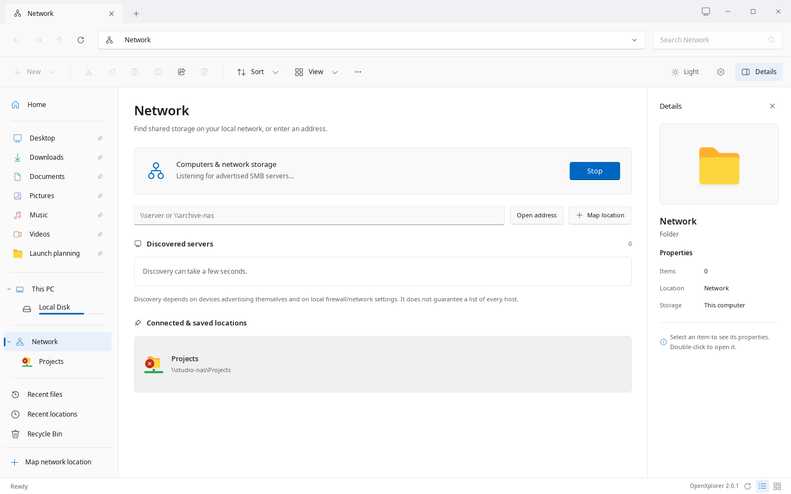
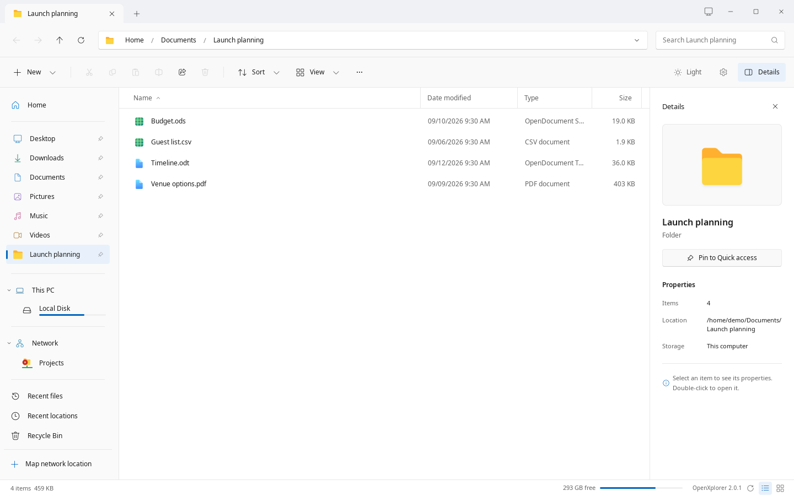

# SMB & network shares

Browse your network without losing your sense of place.

## Connect to a server

Type a server or share address in the address bar, or open Network to see the computers on your network and open one. The address bar also accepts Linux paths, UNC paths and smb:// locations. Each breadcrumb is separately clickable.

Windows-style paths use backslashes, not backticks: \\studio-nas\Projects. You can also use smb://studio-nas/Projects. Click each breadcrumb to jump to an ancestor. The website walkthrough uses this exact interface; the website itself makes no SMB connections.

A slow server shows that it is working, as Windows Explorer does: the address bar fills with progress and Refresh turns into Stop at once, and after a moment the file list says Working on it... in place of the previous folder. Press Stop, or Esc while you are still in the address bar, to cancel and stay where you were. Pressing Enter again does not start over; entering another address replaces the slow one. Other tabs stay usable meanwhile.

```sh
\\nas\Projects
smb://nas/Projects
```



*The native app, captured with fictional sample files. No live NAS connection.*

## Sign in, once per server when possible

The in-app prompt, Enter network credentials, asks for a user name and password, as Windows does. Remember my credentials requests persistent system-keyring storage. When unchecked, reusable credentials are scoped to the Linux login session if the Secret Service session collection is available.

Accounts are scoped by server and port. Different host aliases, rejected credentials, or shares requiring another account may prompt again. A locked keyring can show an operating-system unlock dialog; it is not the SMB credential prompt.

## Keep a share in reach

Map network drive, on the right-click menu of This PC and Network in the navigation pane or in their … menu, asks for a drive letter and a folder such as \\studio-nas\Projects, as in Windows 11. The Drive list offers only the letters no other share is mapped to, the highest one chosen. Save in the sidebar · reconnect when opened (Windows has Reconnect at sign-in) saves the share beneath Network, and OpenXplorer connects it again when you open it; unchecked, the share is listed until OpenXplorer quits. On Linux the letter is only part of its name, such as Projects (Z:). Connect using different credentials asks for an account even when one is saved. Its link Connect to a Web site opens Add a network location, which also connects SFTP, FTP, WebDAV and NFS folders.

Successfully browsed locations appear beneath Network for the session. Right-click a share and choose Keep in Network to save it. Pin a share or a nested folder into the sidebar for a direct route back. Green marks indicate network-backed locations, not guaranteed online status.

The picture shows the sidebar with the sample folder Launch planning pinned to Quick access and the saved share Projects under Network. It was captured from the native app with fictional files and no network, so the share is shown offline.



*The native app, captured with fictional sample files. No live NAS connection.*

## Discover nearby servers

Network lists the computers and servers that advertise themselves on your network, as Windows 11 does, through the installed GVfs discovery providers. It looks each time you open it, and Refresh looks again. Devices must advertise themselves and be reachable through your network and firewall. It does not scan every IP address or guarantee an exhaustive list. If Network says that network discovery is turned off, the GVfs network services are missing; type the server's address instead.

## Bookmarks are not persistent mounts

For a Downloads location or an application that needs a filesystem path, use a persistent CIFS mount. A bookmark such as smb://nas/Downloads is a browsing shortcut, not a system-wide mount. The optional mount helper requires reviewed, explicit administrative action.

## Sign out safely

Finish operations and close files on the server first. Sign out can disconnect matching desktop-session SMB mounts used by other applications. Forgetting saved credentials and removing filename-cache entries are separate choices; neither deletes server files.

---

OpenXplorer 2.0.14. Project-authored documentation: AGPL-3.0-only.
